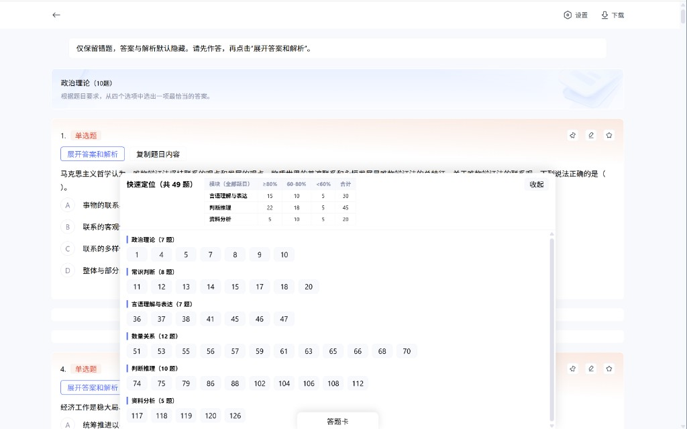

<!--
 * @Author: JiraiyaChen 979526234@qq.com
 * @Date: 2026-09-15 15:51:49
 * @LastEditors: JiraiyaChen 979526234@qq.com
 * @LastEditTime: 2026-11-25 08:56:49
 * @FilePath: \fenbi-wrongbook-extension\README.md
 * @Description: 这是默认设置,请设置`customMade`, 打开koroFileHeader查看配置 进行设置: https://github.com/OBKoro1/koro1FileHeader/wiki/%E9%85%8D%E7%BD%AE
-->
# 粉笔错题重练提取器（Chrome 扩展）

把粉笔试卷结果页一键转换为“只做错题”的重练页面。

## 效果预览

## 主要功能

- 只提取错题：自动识别并保留错题题目，移除做对的题。
- 保持原页面风格：尽量沿用原有样式与结构，阅读体验接近原页面。
- 重做模式：
  - 单选题恢复为真正单选（每题只能选一个）。
  - 隐藏正确/错误高亮，避免提前看到答案提示。
- 答案与解析折叠：
  - 默认隐藏正确答案和解析。
  - 点击“展开答案和解析”再查看，支持收起。
- 复制题目内容：
  - 点击“复制题目内容”可复制“题干 + 选项”。
  - 不包含题号 No。
- 全屏草稿画布：
  - 点击题目工具区“草稿”可打开透明全屏画布，开启画布时自动禁用页面滚轮滑动，避免误触滚动。
  - 右上角有“清空 / 关闭”按钮。
  - 支持 ESC 快速退出画布并恢复页面滚动。
- 底部答题卡与正确率统计：
  - 页面底部“答题卡”按钮可展开抽屉。
  - **按模块分类快速定位**：错题题号按“政治理论 / 常识判断 / 言语理解与表达 / 数量关系 / 判断推理 / 资料分析”等模块分组展示，点击题号可平滑跳转。
  - **全站正确率分布表**：在“快速定位”旁以表格形式统计原试卷中“言语理解与表达”“判断推理”“资料分析”三个模块**全部题目**的全站正确率分布（`≥80%`、`60-80%`、`<60%` 及合计）。

## 安装方法

1. 打开 Chrome 扩展页面：`chrome://extensions/`
2. 打开右上角“开发者模式”
3. 点击“加载已解压的扩展程序”
4. 选择当前目录：`fenbi-wrongbook-extension`

## 使用步骤

1. 打开粉笔试卷结果页（在线页面或本地保存的 HTML 页面）
2. 点击浏览器工具栏中的扩展图标
3. 自动打开新的“错题重练”标签页
4. 在新页面中进行重做、展开解析、使用草稿和答题卡跳转

## 快捷操作

- `ESC`：关闭全屏草稿画布

## 注意事项

- 本扩展基于粉笔结果页 DOM 结构提取内容，若平台页面结构大改，可能需要更新选择器。
- 新页面为静态重练页，已移除原站点脚本，避免脚本冲突导致报错。

## 常见问题

### 1) 点击扩展后没有反应

- 确认当前页面是“已作答结果页”而不是普通练习页。
- 在 `chrome://extensions/` 刷新本扩展后重试。

### 2) 修改了代码但页面没变化

- 扩展管理页点击“刷新”后，再重新点击扩展图标生成新标签页。
- 已打开的旧错题页不会自动热更新。

### 3) 草稿按钮点击无效

- 先确认题目区域存在“草稿”图标。
- 刷新扩展并重新生成错题页。

## 赞赏支持

程序员失业在家备考，希望大家都能上岸~ 2026.11.25
如果这个扩展对你的备考有帮助，欢迎请作者喝杯咖啡：

